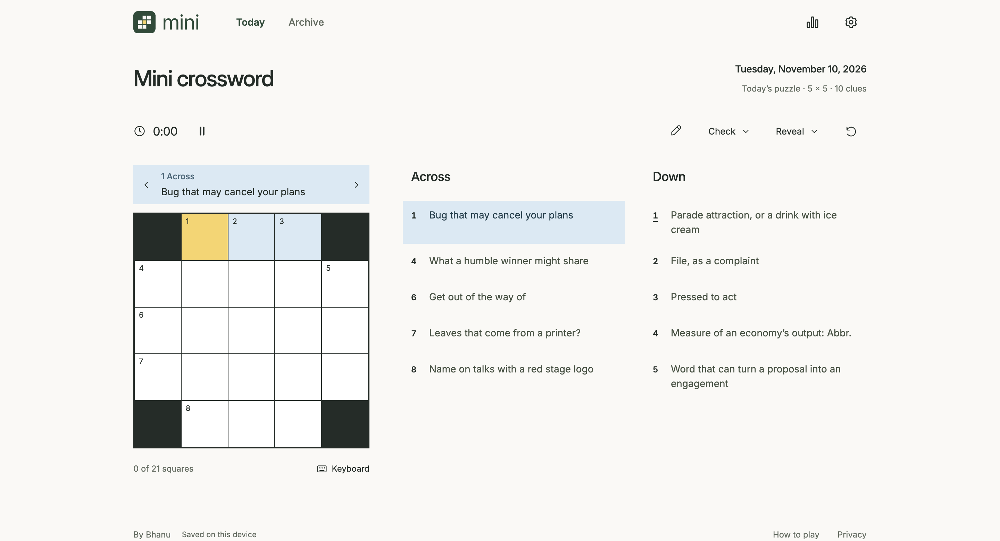
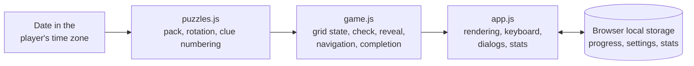

# Mini Crossword

**A daily 5 × 5 crossword with original puzzles. Solve across and down, track your time, and play the past week, with no account and nothing sent anywhere.**

**[Play it → minicrossword.bhanusadhu.com](https://minicrossword.bhanusadhu.com)** (free, no sign-up)



## The problem

Daily mini crosswords are a good five-minute habit, but the popular ones sit behind an account, an app, or a subscription, and most keep your streak on someone else's server. A small puzzle should open instantly, remember where you left off, and not need to know who you are.

**Goal: a puzzle you can finish in a few minutes, that loads at once and works on a phone or a keyboard, with progress that stays on your device.**

## How it works

1. **Open the site.** Today's puzzle loads. It is picked from the date in your own time zone, so it changes at your midnight, not at UTC.
2. **Solve.** Type to fill squares. Arrows, Tab, and tapping a clue move you around. Pressing the selected square again flips between across and down. A touch keyboard appears on small screens.
3. **Get help if you want it.** Pencil mode for guesses, Check and Reveal for a square, a word, or the whole puzzle, and an optional autocheck that marks wrong letters as you type. Any help is recorded, so a revealed solve is never counted as a clean one.
4. **Finish and share.** A solved puzzle shows your time and copies a result to share.
5. **Come back.** Play any of the last seven days from the archive. Your streak and solve count are kept on the device.

## Product decisions

| Decision | Trade-off |
| --- | --- |
| Everything is saved in the browser. There is no account, no analytics, and no server. | Progress and streaks do not follow you to another device, and clearing browser data clears them. The privacy notice says so plainly. |
| Original puzzles, written for this site and not affiliated with any newspaper. | A small pack of seven puzzles that repeat weekly rather than an endless supply. The code calls it a starter pack. |
| The puzzle for a day is a fixed function of the date. | No editor or database to run, and the same date always gives the same puzzle. New puzzles ship with a release. |
| Puzzles are 5 × 5 with 10 clues. | Quick to finish, which is the point, but there is little room for hard grids. A later pack raised clue difficulty instead. |
| Help is allowed but marked. Autocheck and Reveal count as assistance. | Some players will feel judged. Streaks stay honest. |
| An archive of the past seven days, not the full history. | Less to browse, and old puzzles do not pile up. |

## Architecture



A static site with no build step beyond copying files and no runtime dependencies. `puzzles.js` holds the puzzles and the rules that turn a grid into numbered across and down entries. `game.js` is the game state with no page code in it, which is why it is easy to test. `app.js` draws it and handles input. Hosted on Vercel as static files.

## Hard problems

**Picking the right puzzle on every day.** A naive "days since a start date" breaks at daylight-saving changes and at UTC rollover. The date key is built from the player's local calendar parts, and the day count uses UTC only for arithmetic, so a clock change cannot skip or repeat a puzzle. Tests cover the zero-padded key, the weekly repeat, and dates before the first puzzle ([puzzles.test.js](puzzles.test.js)).

**Keeping a harder puzzle pack without breaking old days.** Raising the difficulty must not change what someone solved last week. The earlier pack is kept and used for dates before the new pack's release, and a test asserts that history is preserved ([puzzles.js](puzzles.js)).

**Numbering and answers from a plain grid.** Puzzles are stored as five strings and a clue map. `buildEntries` derives each clue number, its cells, and its answer, including grids with black corners. Tests check every puzzle for complete cluing, crossings, a connected grid, and no runs shorter than three letters ([puzzles.test.js](puzzles.test.js)).

**Restoring saved play safely.** Saved state is validated on load: letters must be A to Z, marks must be known values, and the selected square must be open, so corrupted storage cannot break the grid ([game.js](game.js)).

## Results

- **30 tests pass** (`npm test`, run for this README, using Node's built-in runner). They cover every puzzle's structure, entry numbering and answer paths, local-date keys and the daily rotation, and the site's branding assets.
- **Zero runtime dependencies.** `package.json` lists none.
- **Seven puzzles, 10 clues each,** in the current pack, all checked for crossings and a connected grid.

**Not measured yet.** There are no load-time numbers, no accessibility audit results, no cross-browser test run, and no player data, since the site collects none. Puzzle difficulty is a judgement, not a measured solve time.

## How it was built

1. **The game and a first pack.** Original puzzles, saved play, and the grid logic, with tests from the start.
2. **Interaction and keyboard access.** More tests for interactions, keyboard navigation, and the results screen.
3. **A clean look.** Restyled with simple type and direct product copy, then simplified further.
4. **Branding and sharing.** One logo and share preview across the site, and clue rows aligned.
5. **A denser pack.** Harder clues and a denser schedule, with the earlier pack kept for past dates.

## Tech stack

| Layer | Technology |
| --- | --- |
| Frontend | Plain HTML, CSS, and JavaScript modules |
| State | Browser local storage |
| Tooling | A 7-line build script and a tiny static dev server, both Node |
| Testing | Node's built-in test runner |
| Hosting | Vercel (static files) |

## Run it locally

```bash
npm run dev      # http://127.0.0.1:5173
npm test         # the test suite
npm run build    # copies the site into dist/
npm run assets   # regenerates the logo, icons, and share preview
```

There is nothing to install and no environment variables.

## Project structure

```
index.html, styles.css   The page and its styles
app.js                   Rendering, input, dialogs, stats, sharing
game.js                  Grid state, check, reveal, navigation
puzzles.js               The puzzle packs, rotation, clue numbering
assets/                  Logo, icons, fonts, share preview
scripts/                 Brand asset generator
build.js, server.js      Static build and local server
*.test.js                Tests
```

## What's next

**Known limits.** The pack is seven puzzles that repeat weekly. Progress does not sync between devices. There are no timing or accessibility numbers yet.

**Next.** Write more puzzles so the week does not repeat, run an accessibility audit, and measure how long a typical solve takes.
